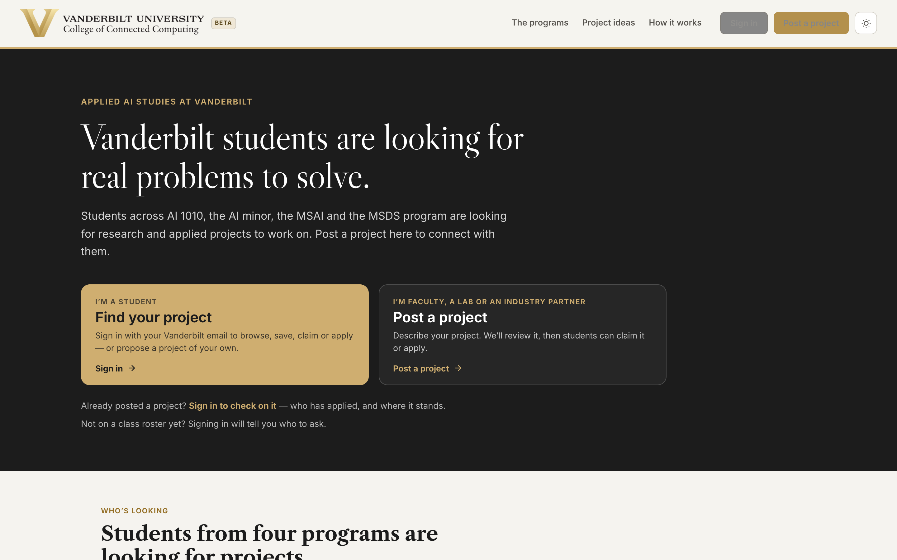
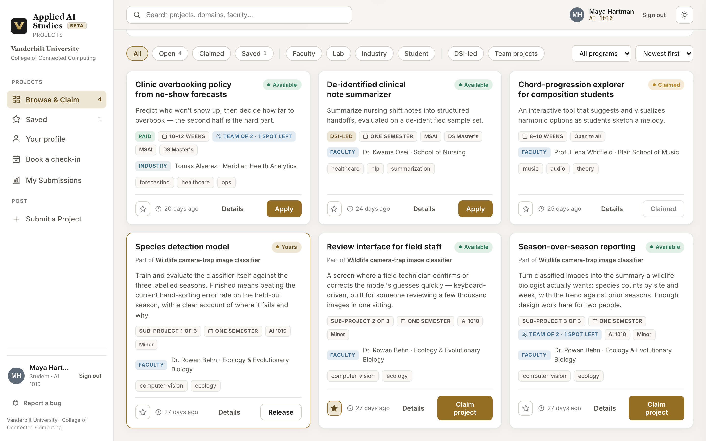
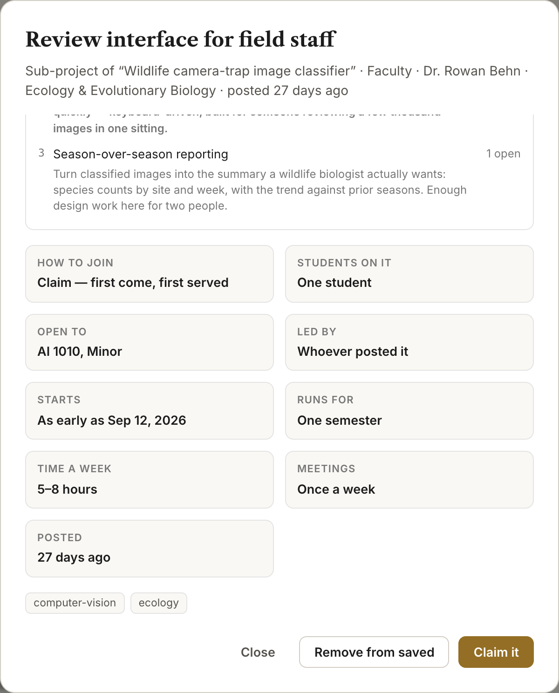
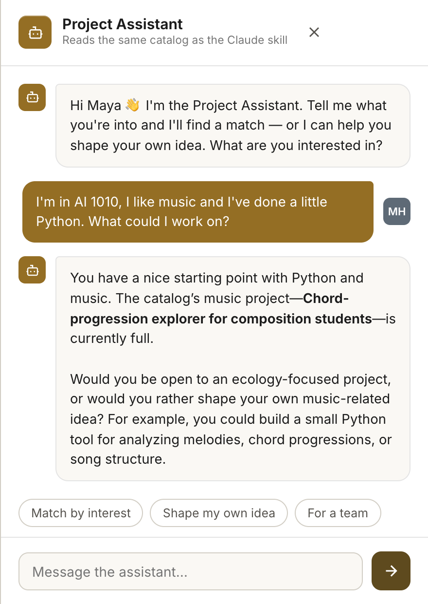
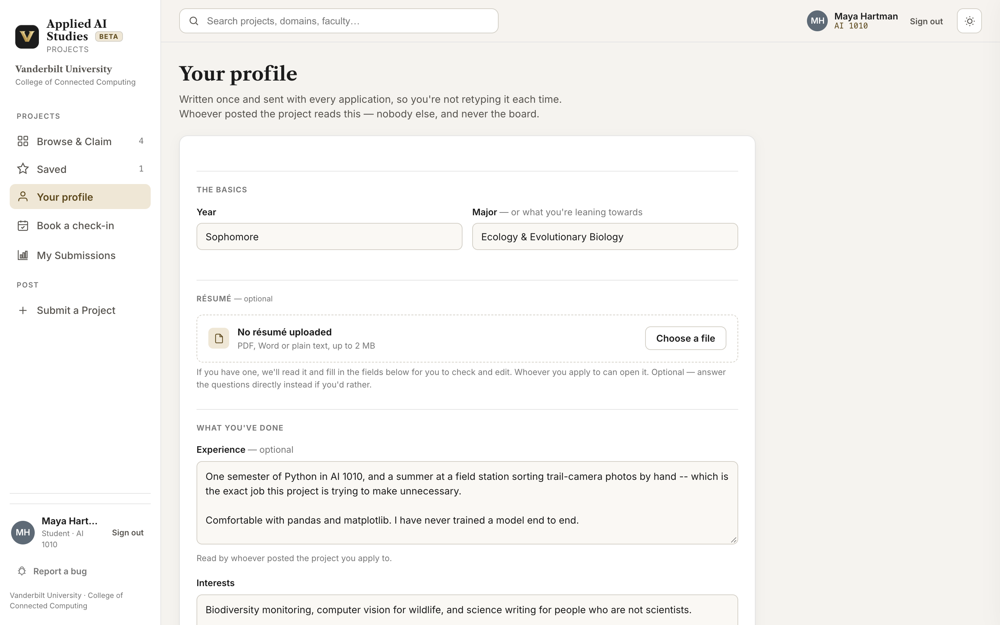
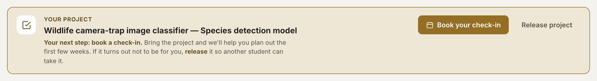

# Finding a project — a student's quick guide

The **Applied AI Studies project board** is where faculty, labs, industry
partners and other students post projects for you to work on. This is the
five-minute version: sign in, find something, take it.

**Project Scoping:** We have created a [CustomGPT](https://chatgpt.com/g/g-6ab3e9f95d288191a1e222c35b0b7caf-vanderbilt-ai-studies-project-scoping) that will help you go from idea to a project proposal. Be sure to log in with your Vanderbilt ChatGPT EDU account to access this. We will also share a claude skill to help you develop your project proposals. 

**The board:** <https://bit.ly/vanderbilt-ai-projects> *(beta)*

---

## 1. Sign in with your Vanderbilt email

Open the board and pick **Find your project**.

The form asks for your email first - you will be asked to create a password. If you get an error, please reach out to us. Make sure to use your Vanderbilt email. 

---

## 2. Browse the board

Every project is one of two kinds, and the card says which:

- **Claim** — first come, first served. Press it and the project is yours.
- **Apply** — you write a few sentences and whoever posted it chooses.

Use the chips to narrow things down (open, claimed, faculty, lab, industry,
student-posted, team projects), the dropdown to filter by your program, and the
**star** on any card to save it for later.

---

## 3. Read the details before you take it

**Details** opens the full picture: how to join, how many students are on it,
which programs it's open to, when it starts, how long it runs, and how many
hours a week it expects. That last number is the one people skip and regret.

> Pick something that sounds interesting, not something you already know how to
> do. Nobody posting here expects you to arrive an expert.

---

## 4. Not sure what to pick? Ask

The **Project Assistant** (bottom-right of every page) reads the same catalog
you're looking at. Describe what you're into — "I like music and I've done a
bit of Python" — and it will point at real projects, or help you shape an idea
of your own.

The same helper exists as a Claude skill in your class's Claude Team, if you'd
rather ask there.

---

## 5. Fill in your profile — before you apply

Written once and sent with every application, so you're not retyping it. Only
the person who posted the project you applied to reads it.

Upload a résumé and a model reads it and fills the boxes in for you to check.
Optional; you can just answer the questions.

---

## 6. Claim it, then book your check-in

Claiming is instant. Applying puts you in a list the sponsor decides on — when
they do, you're told the next time you sign in.

Once a project is yours it sits at the top of the board with your next step on
it. **AI 1010 students need at least one 15-minute check-in** with the team,
booked through Calendly, by the date shown on the board.

If it turns out not to be for you, **Release project** puts it back so someone
else can take it.

---

## Good to know

- **Want to do your own idea?** *Submit a Project* in the sidebar. Once approved it becomes yours
  Automatically. Be sure to sign up for a check in! 
- **Something broken?** *Report a bug* at the bottom of the sidebar, on any
  page. The board is in beta, so you may encounter some bugs. 
